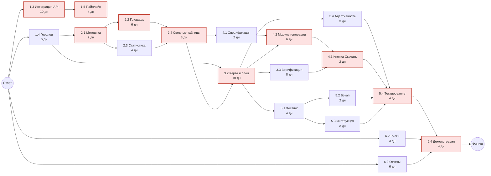
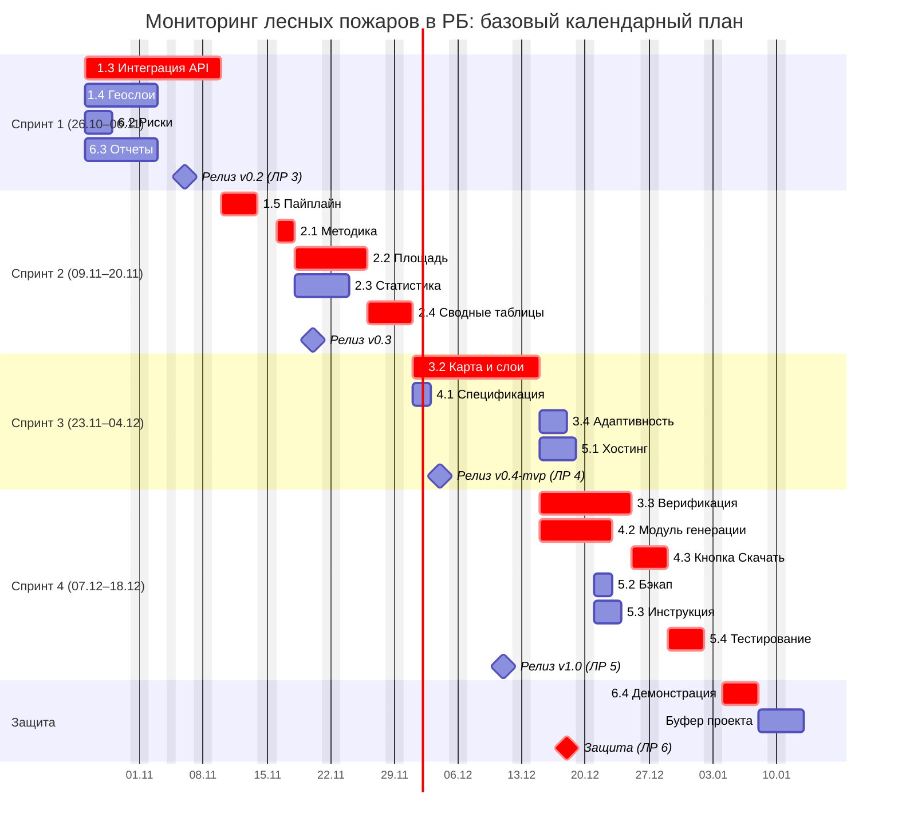

# Календарный план и ресурсы

<!-- TODO: заполните по шагам 3–6 ЛР 3. После утверждения запишите версию и дату. -->

Базовый план, версия 1.0, утверждён 25.10.2026. Изменения после утверждения — только через запрос на изменение.

## 1. Доступное время

- Период разработки: <дата начала> — <дата окончания>, <N> рабочих дней.
- Нерабочие дни: <праздники>.
- Жёсткие вехи: <защита, сдачи ЛР>.

## 2. Сетевой график

| Работа | Длит. | ES | EF | LS | LF | Резерв |
|---|---|---|---|---|---|---|
| 1.3 Интеграция API | 10 | 0 | 10 | 0 | 10 | **0** |
| 1.4 Геослои | 6 | 0 | 6 | 5 | 11 | 5 |
| 6.2 Риски | 3 | 0 | 3 | 40 | 43 | 40 |
| 6.3 Отчеты | 6 | 0 | 6 | 37 | 43 | 37 |
| 1.5 Пайплайн | 4 | 10 | 14 | 10 | 14 | **0** |
| 2.1 Методика | 2 | 14 | 16 | 14 | 16 | **0** |
| 2.2 Площадь | 6 | 16 | 22 | 16 | 22 | **0** |
| 2.3 Статистика | 4 | 16 | 20 | 18 | 22 | 2 |
| 2.4 Сводные таблицы | 3 | 22 | 25 | 22 | 25 | **0** |
| 3.2 Карта и слои | 10 | 25 | 35 | 25 | 35 | **0** |
| 4.1 Спецификация | 2 | 25 | 27 | 33 | 35 | 8 |
| 3.3 Верификация | 8 | 35 | 43 | 35 | 43 | **0** |
| 3.4 Адаптивность | 3 | 35 | 38 | 39 | 42 | 4 |
| 4.2 Модуль генерации | 6 | 35 | 41 | 35 | 41 | **0** |
| 5.1 Хостинг | 4 | 35 | 39 | 37 | 41 | 2 |
| 5.2 Бэкап | 2 | 39 | 41 | 41 | 43 | 2 |
| 5.3 Инструкция | 3 | 39 | 42 | 42 | 45 | 3 |
| 4.3 Кнопка Скачать | 2 | 43 | 45 | 43 | 45 | **0** |
| 5.4 Тестирование | 4 | 45 | 49 | 45 | 49 | **0** |
| 6.4 Демонстрация | 4 | 49 | 53 | 49 | 53 | **0** |

**Критический путь:** 1.3 Интеграция API → 1.5 Пайплайн → 2.1 Методика → 2.2 Площадь → 2.4 Сводные таблицы → 3.2 Карта и слои → 4.2 Модуль генерации → 4.3 Кнопка Скачать → 5.4 Тестирование → 6.4 Демонстрация.

Длина критического пути: 53 рабочих дня.

Сравнение с доступным временем: 
Согласно методичке, доступное время на разработку — 7 рабочих недель (с 26 октября по 11 декабря), что составляет **35 рабочих дней**. Длина нашего критического пути — **53 рабочих дня**. 

**Вывод:** Проект не укладывается в отведённое время (53 > 35). Для решения проблемы приняты следующие решения:
1. **Выполнить работы параллельно:** Задачи 1.3 (Интеграция) и 1.4 (Геослои) выполняются разными исполнителями одновременно. Аналитика (2.3) идет параллельно с разработкой карты (3.2).
2. **Перераспределить людей:** Так как у нас освободился исполнитель, который делал макеты (3.1), он подключается к тестированию (5.4) и генерации отчетов (4.2), чтобы ускорить их.

## 3. Диаграмма Ганта

Буфер: 3 дня. Рассчитан как разница между оценкой 85% и ожидаемой (~6 ч на команду ≈ 2–3 дня при трёх участниках), взят по верхней границе с запасом на декабрь; стоит перед защитой и не раздаётся по задачам.

## 4. Ресурсы

Ёмкость на продукт: <ч в неделю> на человека, <ч> за двухнедельный спринт. Отсутствия: <...>

### Матрица загрузки до выравнивания

| Участник | Sprint 1 | Sprint 2 | Sprint 3 | Sprint 4 |
|---|---|---|---|---|
| | | | | |

### Решения по выравниванию

1. <...>

### Матрица загрузки после выравнивания

| Участник | Sprint 1 | Sprint 2 | Sprint 3 | Sprint 4 | Всего |
|---|---|---|---|---|---|
| | | | | | |

## 5. Релизный план

| Спринт | Даты | Цель спринта | Истории (SP) | Пакеты WBS | Релиз |
|---|---|---|---|---|---|
| | | | | | |

Гипотеза скорости: <...> SP за спринт. Что переносим, если скорость не подтвердится: <...>

Roadmap на доске: <ссылка на представление>
