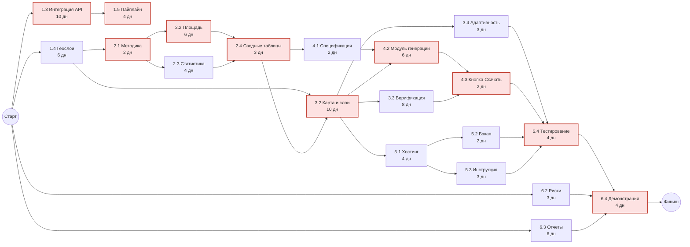

# Календарный план и ресурсы

<!-- TODO: заполните по шагам 3–6 ЛР 3. После утверждения запишите версию и дату. -->

Базовый план, версия 1.0, утверждён 25.10.2026. Изменения после утверждения — только через запрос на изменение.

## 1. Доступное время

- Период разработки: <дата начала> — <дата окончания>, <N> рабочих дней.
- Нерабочие дни: <праздники>.
- Жёсткие вехи: <защита, сдачи ЛР>.

## 2. Сетевой график

| Работа | Длит. | ES | EF | LS | LF | Резерв |
|---|---|---|---|---|---|---|
| 1.3 Интеграция API | 10 | 0 | 10 | 0 | 10 | **0** |
| 1.4 Геослои | 6 | 0 | 6 | 5 | 11 | 5 |
| 6.2 Риски | 3 | 0 | 3 | 40 | 43 | 40 |
| 6.3 Отчеты | 6 | 0 | 6 | 37 | 43 | 37 |
| 1.5 Пайплайн | 4 | 10 | 14 | 10 | 14 | **0** |
| 2.1 Методика | 2 | 14 | 16 | 14 | 16 | **0** |
| 2.2 Площадь | 6 | 16 | 22 | 16 | 22 | **0** |
| 2.3 Статистика | 4 | 16 | 20 | 18 | 22 | 2 |
| 2.4 Сводные таблицы | 3 | 22 | 25 | 22 | 25 | **0** |
| 3.2 Карта и слои | 10 | 25 | 35 | 25 | 35 | **0** |
| 4.1 Спецификация | 2 | 25 | 27 | 33 | 35 | 8 |
| 3.3 Верификация | 8 | 35 | 43 | 35 | 43 | **0** |
| 3.4 Адаптивность | 3 | 35 | 38 | 39 | 42 | 4 |
| 4.2 Модуль генерации | 6 | 35 | 41 | 35 | 41 | **0** |
| 5.1 Хостинг | 4 | 35 | 39 | 37 | 41 | 2 |
| 5.2 Бэкап | 2 | 39 | 41 | 41 | 43 | 2 |
| 5.3 Инструкция | 3 | 39 | 42 | 42 | 45 | 3 |
| 4.3 Кнопка Скачать | 2 | 43 | 45 | 43 | 45 | **0** |
| 5.4 Тестирование | 4 | 45 | 49 | 45 | 49 | **0** |
| 6.4 Демонстрация | 4 | 49 | 53 | 49 | 53 | **0** |

**Критический путь:** 1.3 Интеграция API → 1.5 Пайплайн → 2.1 Методика → 2.2 Площадь → 2.4 Сводные таблицы → 3.2 Карта и слои → 4.2 Модуль генерации → 4.3 Кнопка Скачать → 5.4 Тестирование → 6.4 Демонстрация.

Длина критического пути: 53 рабочих дня.

Сравнение с доступным временем: 
Согласно методичке, доступное время на разработку — 7 рабочих недель (с 26 октября по 11 декабря), что составляет **35 рабочих дней**. Длина нашего критического пути — **53 рабочих дня**. 

**Вывод:** Проект не укладывается в отведённое время (53 > 35). Для решения проблемы приняты следующие решения:
1. **Выполнить работы параллельно:** Задачи 1.3 (Интеграция) и 1.4 (Геослои) выполняются разными исполнителями одновременно. Аналитика (2.3) идет параллельно с разработкой карты (3.2).
2. **Перераспределить людей:** Так как у нас освободился исполнитель, который делал макеты (3.1), он подключается к тестированию (5.4) и генерации отчетов (4.2), чтобы ускорить их.

## 3. Диаграмма Ганта

Буфер: 3 дня. Рассчитан как разница между оценкой 85% и ожидаемой (~6 ч на команду ≈ 2–3 дня при трёх участниках), взят по верхней границе с запасом на декабрь; стоит перед защитой и не раздаётся по задачам.

## 4. Ресурсы

### Ёмкость команды

В [уставе](charter.md) заложено 6 ч в неделю на участника. По [оценке управленческой работы](estimation.md#2-трёхточечная-оценка-пакетов-работ-pert) из них 1 ч в неделю отведён на встречи и отчёты. Для расчёта берём 1 ч работы над продуктом на каждый рабочий день. В Sprint 1 исключён праздник 4 ноября, как в диаграмме Ганта. На 27.11.2026 индивидуальные отсутствия и прочие обязательства ещё нужно подтвердить с участниками. Таблица показывает ёмкость до этих уточнений.

| Участник | Sprint 1 · 26.10–06.11 | Sprint 2 · 09–20.11 | Sprint 3 · 23.11–04.12 | Sprint 4 · 07–18.12 | Всего до 11.12 | Всего до 18.12 |
|---|---:|---:|---:|---:|---:|---:|
| Айнур С. (@moonEkho) | 9 ч | 10 ч | 10 ч | 10 ч (5 до 11.12) | 34 ч | 39 ч |
| Юлия З. (@tenten693) | 9 ч | 10 ч | 10 ч | 10 ч (5 до 11.12) | 34 ч | 39 ч |
| Данил М. (@YatoTokemyri) | 9 ч | 10 ч | 10 ч | 10 ч (5 до 11.12) | 34 ч | 39 ч |
| **Команда** | **27 ч** | **30 ч** | **30 ч** | **30 ч (15 до 11.12)** | **102 ч** | **117 ч** |

В Sprint 4 веха релиза стоит 11.12, защита 18.12. До релиза доступны 34 рабочих дня с учётом 4 ноября. Неделя 14–18.12 входит в Sprint 4 и показана отдельно при проверке срока релиза.

### Матрица загрузки до выравнивания

Взяты 20 пакетов с оценкой PERT из [оценок](estimation.md), владельцы из [WBS](wbs.md), длительности, даты и зависимости `after` из диаграммы Ганта в разделе 3. Недельные окна взяты по датам. Для пакета, который пересекает границу спринта, часы поделены пропорционально рабочим дням. Например, из 10 дней пакета 1.3 девять попадают в Sprint 1 (39,0 ч) и один в Sprint 2 (4,3 ч). Считаем по точным значениям PERT и округляем при выводе. Процент равен отношению часов в ячейке к ёмкости участника в том же спринте. Буфер и вехи не добавляют трудоёмкости. Спайки #91 и #92 в этом расчёте исходного графика отсутствуют, поскольку в диаграмме для них нет дат.

| Участник | Sprint 1 | Sprint 2 | Sprint 3 | Sprint 4 · 07–18.12 | После 18.12 | Всего |
|---|---:|---:|---:|---:|---:|---:|
| @moonEkho | 65,0 ч (722%) | 17,3 ч (173%) | 13,0 ч (130%) | 0,0 ч (0%) | 0,0 ч | 95,3 ч |
| @tenten693 | 39,0 ч (433%) | 21,7 ч (217%) | 26,0 ч (260%) | 13,0 ч (130%) | 17,3 ч | 117,0 ч |
| @YatoTokemyri | 0,0 ч (0%) | 17,3 ч (173%) | 17,3 ч (173%) | 78,0 ч (780%) | 73,7 ч | 186,3 ч |
| **Команда** | **104,0 ч** | **56,3 ч** | **56,3 ч** | **91,0 ч** | **91,0 ч** | **398,7 ч** |

Из 91,0 ч в Sprint 4 только 21,7 ч попадает до 11.12. Это работа Данила по 3.2 при личной ёмкости 5 ч (433%). На 14–18.12 выпадает ещё 69,3 ч (13,0 ч Юлии и 56,3 ч Данила). Пакет 3.2 по зависимостям Ганта занимает 01–14.12 и выходит за веху 04.12. Для 2.1 использована зависимость от 1.5 из Ганта. Сетевая диаграмма в разделе 2 задаёт 1.4 как предшественника 2.1, поэтому её нужно сверить с Гантом при пересмотре плана.

Распределение исходных часов по пакетам WBS

| WBS | Владелец | Sprint 1 | Sprint 2 | Sprint 3 | 07–11.12 | 14–18.12 | После 18.12 |
|---|---|---:|---:|---:|---:|---:|---:|
| 1.3 | @moonEkho | 39,0 | 4,3 | — | — | — | — |
| 1.4 | @moonEkho | 26,0 | — | — | — | — | — |
| 6.2 | @tenten693 | 13,0 | — | — | — | — | — |
| 6.3 | @tenten693 | 26,0 | — | — | — | — | — |
| 1.5 | @YatoTokemyri | — | 17,3 | — | — | — | — |
| 2.1 | @tenten693 | — | 8,7 | — | — | — | — |
| 2.2 | @moonEkho | — | 13,0 | 13,0 | — | — | — |
| 2.3 | @tenten693 | — | 13,0 | 4,3 | — | — | — |
| 2.4 | @tenten693 | — | — | 13,0 | — | — | — |
| 3.2 | @YatoTokemyri | — | — | 17,3 | 21,7 | 4,3 | — |
| 4.1 | @tenten693 | — | — | 8,7 | — | — | — |
| 3.4 | @tenten693 | — | — | — | — | 13,0 | — |
| 5.1 | @YatoTokemyri | — | — | — | — | 17,3 | — |
| 3.3 | @YatoTokemyri | — | — | — | — | 17,3 | 17,3 |
| 4.2 | @YatoTokemyri | — | — | — | — | 17,3 | 8,7 |
| 4.3 | @YatoTokemyri | — | — | — | — | — | 8,7 |
| 5.2 | @YatoTokemyri | — | — | — | — | — | 8,7 |
| 5.3 | @YatoTokemyri | — | — | — | — | — | 13,0 |
| 5.4 | @tenten693 | — | — | — | — | — | 17,3 |
| 6.4 | @YatoTokemyri | — | — | — | — | — | 17,3 |

### Решения по выравниванию

1. Переназначения и сдвиги в пределах резервов не устраняют дефицит. Даже при загрузке каждого на 110% команда может выделить 112,2 ч до 11.12 или 128,7 ч до 18.12. Это меньше 398,7 ч исходного объёма. До 11.12 потребуется изменить объём работ контрольной точки или согласовать иной срок и пересчитать план.
2. Предложение на 27.11.2026 для обсуждения с командой и заказчиком — до 11.12 выполнить проверки источников, перечисленные ниже. Результат контрольной точки — материалы о доступности данных и оценка следующего шага. Полный MVP и его критерии остаются открытыми. Даты оставшихся работ, объём поставки и вехи входят в запрос на изменение. Итоговое решение нужно зафиксировать в задаче или протоколе и учесть в релизном плане [#79](https://github.com/YatoTokemyri/pm-lab-8-ForestFireMonitoring/issues/79) и на контрольной точке [#84](https://github.com/YatoTokemyri/pm-lab-8-ForestFireMonitoring/issues/84).
3. Работы поставлены с ближайшей полной рабочей недели, 30.11. Sprint 1 и Sprint 2 уже прошли. Часы до 30.11 по фактически выполненной работе здесь не восстановлены. Для предстоящих работ выделено по 5 ч на участника в каждом из двух оставшихся рабочих окон до релиза. Неделя защиты не используется для этой поставки. При подтверждении отсутствий или других назначений нужно обновить ёмкость и повторить проверку.

| Задача в предложении | Ответственный | 30.11–04.12 | 07–11.12 | Всего | Результат |
|---|---|---:|---:|---:|---|
| [#91](https://github.com/YatoTokemyri/pm-lab-8-ForestFireMonitoring/issues/91) · проверка данных о камерах | @moonEkho | 3 ч | 3 ч | 6 ч | Источники, подтверждённые параметры и пробелы. Результат нужен [#87](https://github.com/YatoTokemyri/pm-lab-8-ForestFireMonitoring/issues/87). |
| [#92](https://github.com/YatoTokemyri/pm-lab-8-ForestFireMonitoring/issues/92) · доступность истории пожаров | @tenten693 | 4 ч | 0 ч | 4 ч | Сводка по территориям, годам, полям и лицензиям. Результат нужен [#55](https://github.com/YatoTokemyri/pm-lab-8-ForestFireMonitoring/issues/55). |
| Подзадача [#86](https://github.com/YatoTokemyri/pm-lab-8-ForestFireMonitoring/issues/86) · пробная выгрузка NASA FIRMS (WBS 1.3) | @YatoTokemyri | 4 ч | 4 ч | 8 ч | Инструкция и результат тестовой попытки, включая доступные поля либо причину блокировки. Лимит относится к части WBS 1.3. Приёмка всей истории #86 проводится отдельно. |

### Матрица загрузки после выравнивания

Вариант для согласования. В каждой ячейке указаны часы из таблицы работ и доля от доступной ёмкости оставшейся части спринта.

| Участник | Sprint 1 | Sprint 2 | Sprint 3 · остаток 30.11–04.12 | Sprint 4 · до релиза 07–11.12 | Всего в предложении |
|---|---|---|---:|---:|---:|
| @moonEkho | — | — | 3 из 5 ч (60%) | 3 из 5 ч (60%) | 6 из 10 ч |
| @tenten693 | — | — | 4 из 5 ч (80%) | 0 из 5 ч (0%) | 4 из 10 ч |
| @YatoTokemyri | — | — | 4 из 5 ч (80%) | 4 из 5 ч (80%) | 8 из 10 ч |
| **Команда** | — | — | **11 из 15 ч** | **7 из 15 ч** | **18 из 30 ч** |

Максимальная индивидуальная загрузка в предложении — 80%. Прочерк означает, что окно завершилось до даты пересмотра и в предложение не входит. Фактическая загрузка прошедших спринтов требует отдельной сверки. 12 ч остатка ёмкости не распределены.
## 5. Релизный план

| Спринт | Даты | Цель спринта | Истории (SP) | Пакеты WBS | Релиз |
|---|---|---|---|---|---|
| | | | | | |

Гипотеза скорости: <...> SP за спринт. Что переносим, если скорость не подтвердится: <...>

Roadmap на доске: <ссылка на представление>
