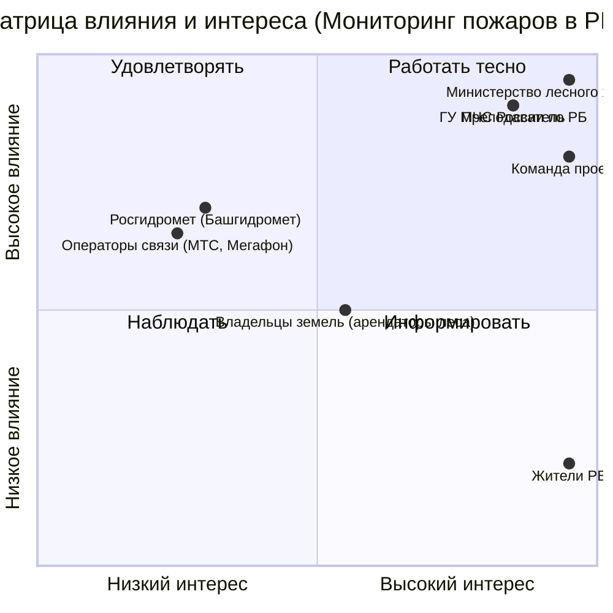

# Стейкхолдеры, матрица влияния и интереса, RACI

<!-- TODO: шаг 4 задания ЛР 1. Минимум 8 стейкхолдеров и 8 работ в RACI. -->

## Реестр
| Стейкхолдер | Роль | Что ожидает | Влияние (1–5) | Интерес (1–5) | Как работаем |
|---|---|---|---|---|---|
|Министерство лесного хозяйства РБ| Заказчик| Точное картографирование очагов возгорания, отчеты для руководства| 5| 5| Еженедельные отчёты, предоставление чернового варианта системы |
|Главное управление МЧС России по РБ|Оператор|Получение сигналов тревоги|5|4|Согласование формата экстренного уведомления (SMS) и регламента передачи координат|
| Команда проекта | Исполнители | Четкие требования, стабильный доступ к данным | 4 | 5 | Короткие ежедневные встречи и общий список задач |
| Преподаватель | Куратор | Соответствие требованиям курса | 5 | 4 | Плотно, на каждой контрольной точке |
| Росгидромет (Башгидромет) |   Поставщик данных | Корректное использование метеоданных | 3 | 2 | Запрос данных |
| Операторы связи (МТС, Мегафон и др.) | Технические партнеры | Отсутствие перегрузки сети при рассылке SMS | 4 | 2 | Согласование лимитов на массовые рассылки |
| Жители РБ (особенно сельские районы) | Пользователи | Своевременное оповещение об угрозе, интерактивная карта мониторинга пожаров | 2 | 5 | Информирование, тестирование мобильного приложения |
| Владельцы земель (арендаторы леса) | Затронутые лица | Минимизация ущерба, доступ к прогнозам | 3 | 3 | Информационные рассылки |

## Матрица влияния и интереса
Координаты по осям от 0 до 1. Замените примеры своими стейкхолдерами.

## RACI
В каждой строке ровно одна буква A.

| Работа | Менеджер проекта | Аналитик | Тех. организатор | Заказчик |
|---|---|---|---|---|
| Работа | Менеджер проекта | Аналитик | Тех. организатор | Заказчик |
| Устав проекта | A | C | I | C |
| Реестр стейкхолдеров | A | R | I | C |
| Матрица рисков | A | R | I | C |
| Сбор требований к карте пожаров | C | R | I | A |
| Выбор источников спутниковых данных | I | C | R | A |
| Разработка алгоритма обнаружения дыма | A | C | R | I |
| Настройка SMS-оповещений | A | I | R | C |
| Тестирование системы | A | C | R | I |
| Утверждение финального бюджета | R | I | I | A |

## Интервью с заказчиком
Протокол: [docs/meetings/](meetings/)
