# Иерархическая структура работ (WBS)

<!-- TODO: шаг 3 задания ЛР 2. WBS делит результаты проекта, а не действия. Первый уровень совпадает с эпиками E1–E6. Правило 100%: в WBS есть все работы проекта и ничего лишнего. Пакет работ: 8–80 часов, один ответственный, проверяемый результат. -->

## Диаграмма

```mermaid
flowchart TD
    P["0. Мониторинг лесных пожаров в РБ"]
    P --> D["1. Данные · E1"]
    P --> A["2. Аналитика · E2"]
    P --> U["3. Пользовательский интерфейс · E3"]
    P --> R["4. Отчётность · E4"]
    P --> Q["5. Платформа и качество · E5"]
    P --> M["6. Управление проектом · E6"]

    D --> D1["1.1 Реестр источников"]
    D --> D2["1.2 Датасет пожаров"]
    D --> D3["1.3 Интеграция спутников"]
    D --> D4["1.4 Геослои и камеры"]
    D --> D5["1.5 Пайплайн обновления"]

    A --> A1["2.1 Методика слепых зон"]
    A --> A2["2.2 Площадь слепых зон"]
    A --> A3["2.3 Статистика в слепых зонах"]
    A --> A4["2.4 Таблицы показателей"]

    U --> U1["3.1 Макет и дизайн"]
    U --> U2["3.2 Карта и слои"]
    U --> U3["3.3 Ручная верификация"]
    U --> U4["3.4 Адаптивность и тесты"]

    R --> R1["4.1 Форматы отчётов"]
    R --> R2["4.2 Генерация отчётов"]
    R --> R3["4.3 Интеграция в UI"]

    Q --> Q1["5.1 Инфраструктура"]
    Q --> Q2["5.2 Бэкапы"]
    Q --> Q3["5.3 README"]
    Q --> Q4["5.4 Тесты качества"]

    M --> M1["6.1 Документация"]
    M --> M2["6.2 Риски"]
    M --> M3["6.3 Отчёты ЛР"]
    M --> M4["6.4 Сдача"]
```

## Словарь WBS

Для каждого пакета работ (нижний уровень WBS).

| Код | Пакет работ | Результат | Критерий готовности | Ответственный | Оценка, ч | Эпик / Issues |
|---|---|---|---|---|---|---|
| 1.1 | Реестр источников данных | `data/sources.md` | 3+ спутниковых источника, оценка лицензий (DR-04) | @moonEkhо | 12 | E1 |
| 1.2 | Исторический датасет пожаров | `data/fires_history.csv` | Данные за 5 лет, сверены с официальной статистикой (DR-01) | @moonEkhо | 20 | E1 |
| 1.3 | Интеграция спутниковых данных | Скрипты загрузки API | Автоматическая выгрузка, задержка < 24 ч (DR-03) | @moonEkhо | 40 | E1 |
| 1.4 | Геослои лесного фонда и камер | `data/layers/` (GeoJSON) | Границы леса и зоны покрытия «Лесохранитель» корректны (FR-02) | @moonEkhо | 24 | E1 |
| 1.5 | Пайплайн обновления данных | Скрипт `update_data.py` | Регулярное обновление по расписанию | @YatoTokemyri | 16 | E1 |
| 2.1 | Методика расчёта слепых зон | `docs/methodology.md` | Описана формула и логика пространственного пересечения | @tenten693 | 8 | E2 |
| 2.2 | Расчёт площади слепых зон | Таблица площадей | Площадь без камер рассчитана в кв. км (FR-05) | @moonEkhо | 24 | E2 |
| 2.3 | Статистика пожаров в слепых зонах | Аналитическая сводка | Собраны данные о пожарах на непокрытых территориях (FR-05) | @tenten693 | 16 | E2 |
| 2.4 | Сводные таблицы показателей | `docs/metrics.md` | Таблицы с процентами покрытия и плотностью пожаров | @tenten693 | 12 | E2 |
| 3.1 | Макет и дизайн-система | Figma-макет | Согласован состав экранов и UI-элементы | @YatoTokemyri | 16 | E3 |
| 3.2 | Интерактивная карта и слои | Экран карты | Слои (аномалии, лес, камеры) переключаются без лагов (NFR-01) | @YatoTokemyri | 40 | E3 |
| 3.3 | Модуль ручной верификации очагов | Компонент подтверждения | Подтверждение очага за ≤ 3 клика (NFR-02, FR-04) | @YatoTokemyri | 32 | E3 |
| 3.4 | Адаптивность и юзабилити-тесты | Отчёт по UI-тестам | Проверка на 1280 px и 768 px (NFR-03) | @tenten693 | 12 | E3 |
| 4.1 | Спецификация форматов отчётов | `docs/reports_spec.md` | Согласован формат (PDF/Excel/дашборд) с заказчиком | @tenten693 | 8 | E4 |
| 4.2 | Модуль генерации отчётов | Скрипт/сервис экспорта | Выгрузка статистики по пожарам и слепым зонам | @YatoTokemyri | 24 | E4 |
| 4.3 | Интеграция отчётов в интерфейс | Кнопка «Скачать отчёт» | Отчёт скачивается из панели диспетчера в 1 клик | @YatoTokemyri | 8 | E4 |
| 5.1 | Инфраструктура и хостинг | Развёрнутый сервер | Прототип доступен по публичной ссылке | @YatoTokemyri | 16 | E5 |
| 5.2 | Настройка резервного копирования | Cron-скрипт бэкапа | Ежедневный дамп БД сохраняется во внешнее хранилище | @YatoTokemyri | 8 | E5 |
| 5.3 | Инструкция по развертыванию README | `README.md` | Развертывание с нуля за 15 минут (NFR-04) | @YatoTokemyri | 12 | E5 |
| 5.4 | Протоколы тестирования качества | `docs/qa_report.md` | Замеры Lighthouse и результаты тестов | @tenten693 | 16 | E5 |
| 6.1 | Пакет проектной документации | Устав, Требования, WBS | Документы сданы и утверждены (ЛР 1–3) | @YatoTokemyri | 24 | E6 |
| 6.2 | Реестр рисков и план качества | `docs/risks.md` | Риски оценены, назначены реакции (R1–R8) | @tenten693 | 12 | E6 |
| 6.3 | Отчёты по ЛР и презентации | Папка `docs/lr_reports/` | Сданы отчёты по всем лабораторным работам | @tenten693 | 24 | E6 |
| 6.4 | Финальная демонстрация и сдача | Демо и релиз v1.0 | Демонстрация заказчику, защита проекта | @YatoTokemyri | 16 | E6 |
